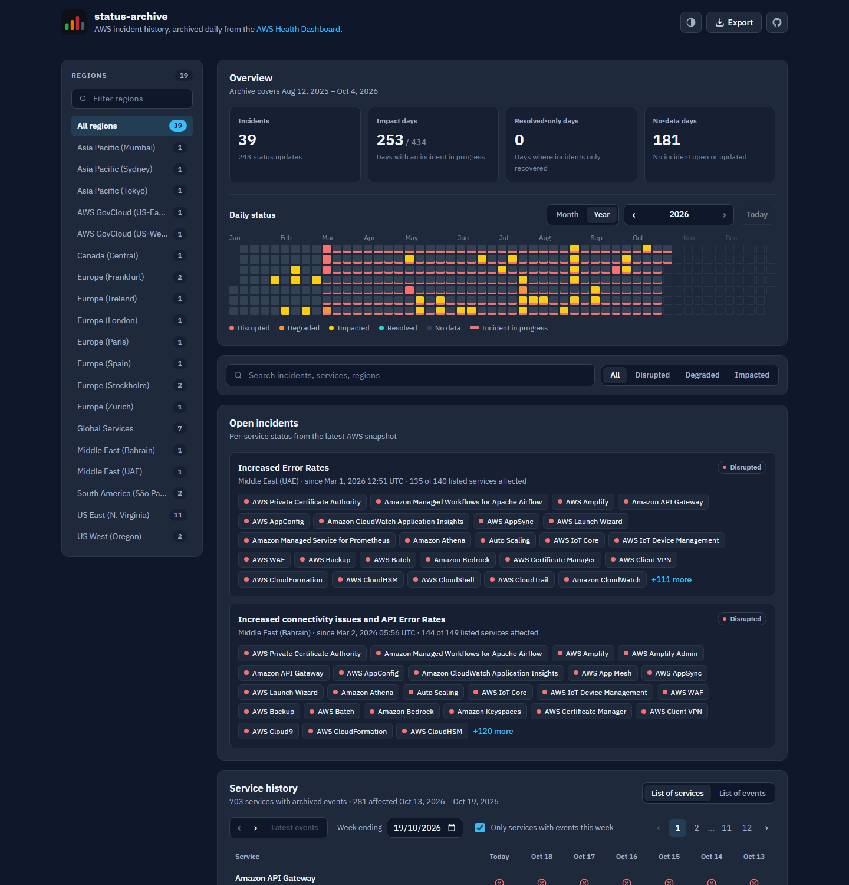

# AWS Status Archive

**AWS outages shouldn't disappear after 12 months.**

The [AWS Health Dashboard](https://health.aws.amazon.com/health/status) only shows the last 12 months of service history. This project snapshots AWS's public health data into Git every day and keeps every event permanently, so past outages stay searchable after AWS drops them.

**[Browse the live archive →](https://mimobn.github.io/aws-status-archive/)**



## Why it exists

* **AWS forgets, the archive doesn't.** As of October 2026 the archive holds 39 incidents; AWS's own dashboard still lists 28 of them. The other 11 aged out of AWS's window and are kept here.
* **Every snapshot is a Git commit.** The raw AWS JSON is committed daily, so any number on the site can be traced back to what AWS published, and the whole dataset can be rebuilt from history.
* **No report is not "healthy".** Days when AWS posted nothing are shown as *no data*, never as operational, so the archive doesn't overstate uptime.

## What you get

* **Daily status calendar** by year or month, counting an incident on every day it was in progress.
* **Service history** in the same two views as the AWS dashboard: a list of services with a status per day, and a list of events.
* **Incident details** with the full update timeline and every affected service, ranked by the worst status it reached.
* **Open incidents** with live per-service status from the latest snapshot.
* **Filters** by Region, severity, day and text, all kept in the URL so any view can be shared.
* **CSV and JSON export** of whatever is filtered.
* **A read-only API** (FastAPI + SQLite) for your own analysis.

Run it locally with one command (needs Python 3.13+ and [uv](https://docs.astral.sh/uv/)):

```bash
uv run python scripts/serve.py
```

Then open http://127.0.0.1:8000/.

## Table of Contents

* [The Idea](#the-idea)
* [Live Page](#live-page)
* [Quick Start](#quick-start)
* [API](#api)
* [Tests](#tests)
* [Data](#data)
* [Technology](#technology)
* [Contributing](#contributing)
* [License](#license)

## The Idea

AWS publishes public service health information through its Service Health Dashboard. The Service History currently provides a rolling view of AWS service interruptions from the previous 12 months. This project preserves that information by periodically archiving the underlying public data.

The archive is built from three public JSON files:

| File                 | Description                                           |
| -------------------- | ----------------------------------------------------- |
| `services.json`      | Service and Region catalog with display names         |
| `historyevents.json` | Historical and ongoing incidents with update logs     |
| `currentevents.json` | Currently open incidents and per-service availability |

A scheduled workflow fetches these files and stores each snapshot in Git. This makes the historical data reproducible and auditable.

The rebuild process then combines the archived snapshots into a normalized dataset containing:

* AWS service and Region incidents
* Incident timelines and status updates
* Severity levels
* Regional breakdowns
* Per-service availability
* Archive metadata

The resulting data is written to both SQLite and JSON for use by the API and the public website.

## Live Page

The public archive is available at:

**https://mimobn.github.io/aws-status-archive/**

The site is static and is rebuilt automatically when a new archive snapshot is added.

Everything displayed on the site is derived from the archived AWS data. No incidents or status observations are manually seeded or fabricated.

Every view has a shareable URL. For example, Mumbai incidents with a worst status of impacted:
`https://mimobn.github.io/aws-status-archive/#region=Asia+Pacific+%28Mumbai%29&sev=impacted`

## Quick Start

Requirements:

* Python 3.13+
* [uv](https://docs.astral.sh/uv/)

Install the project dependencies:

```bash
uv sync
```

Fetch the latest public data from AWS and merge into the permanent archive:

```bash
uv run python scripts/fetch_archive.py
uv run python scripts/merge_archive.py
```

Rebuild the database and generated JSON:

```bash
uv run python scripts/rebuild.py
```

Run the integrity checks:

```bash
uv run python scripts/check_integrity.py
```

Run the site locally:

```bash
uv run python scripts/serve.py
```

Then open **http://127.0.0.1:8000/** in your browser.

Start the local API:

```bash
uv run uvicorn api.main:app --port 8001
```

The interactive API documentation is available at:

**http://localhost:8001/docs**

## API

The FastAPI backend is read-only and primarily intended for local use and development.

The public website uses the generated static data rather than exposing this API directly.

| Endpoint               | Description                                             |
| ---------------------- | ------------------------------------------------------- |
| `GET /healthz`         | Health check, archive counts, and freshness information |
| `GET /incidents`       | List archived incidents (supports `?region=`, `?service=`, `?open=true`)  |
| `GET /incidents/{key}` | Incident details using full or short key (e.g. `slug_date`), timeline, and affected services |
| `GET /regions`         | Regions with incident counts                            |
| `GET /updates`         | Recent status updates (supports `?severity=`, `?limit=1–1000`)  |
| `GET /metrics`         | Aggregate statistics and archive metadata               |
| `GET /metadata`        | Archive date range, counts, and rebuild information     |

## Tests

Run the test suite with:

```bash
uv run python -m unittest discover -s tests
```

The tests cover:

* Data parsing
* Incident construction
* Archive differences
* Integrity checks
* Archive structure validation

Tests use real sample data stored in `fixtures/`.

## Data

### Data Sources

Each archived snapshot contains the public AWS data used to reconstruct the service health history.

#### `services.json`

Contains the AWS service and Region catalog, including display names and identifiers.

#### `historyevents.json`

Contains historical and ongoing public service incidents together with their update logs.

#### `currentevents.json`

Contains currently open incidents and per-service availability information.

Snapshots are stored in Git, allowing the archive to preserve the state published by AWS at each collection time.

### Data Semantics

#### Archive and Retention

A daily GitHub Actions job fetches the latest AWS public health data and merges it into a permanent archive. The raw snapshots are stored in `data/`, and a parallel archive in `data/archive/` preserves all historical data by merging (never deleting) each snapshot.

To merge the current `data/` files into the permanent archive:

```bash
uv run python scripts/merge_archive.py
```

To rebuild the entire archive from Git history:

```bash
uv run python scripts/merge_archive.py --backfill-from-git
```

During rebuild, the archive data sources (`data/archive/{historyevents,currentevents,services}.json`) are read first; if missing, the raw snapshot files in `data/` are used as a fallback.

#### Archived Snapshot

An archived snapshot represents a point-in-time dump of the public AWS Service Health Dashboard data.

Each snapshot contains:

* The AWS service catalog
* Historical incidents and their update logs
* Currently open incidents
* Per-service availability information

#### Incident

An incident represents a service and Region event during a specific time window.

For example:

```text
ec2-us-east-1#1234567890
```

Incident records are keyed using the service identifier and event start timestamp. Each incident carries:

* `arn`: AWS ARN identifier for the event
* `open`: boolean indicating whether the incident is still open in the latest raw `currentevents.json`

#### Status Update

A status update is a timestamped entry in an incident's event log.

The timestamps represent publication times recorded by AWS. They should not necessarily be interpreted as the exact moment when the underlying service state changed.

#### Per-Service Breakdown

Each incident includes a per-service breakdown derived from the history events' own `impacted_services` field. For open incidents, this breakdown is overlaid with the matching open event from `currentevents.json` (matched by ARN) to reflect the freshest per-service status.

#### Absence of an Incident

The archive does **not** provide continuous health observations.

AWS public event data is incident-based. Therefore:

> No incident does not mean confirmed healthy operation.

A day with no archived incident activity is classified as **No Data**, rather than as confirmed operational.

#### No Data vs Operational

The archive distinguishes between:

* **Operational**: an explicit operational status update associated with an incident, typically indicating resolution.
* **No Data**: no archived incident activity was recorded for the period.

This distinction prevents periods without incident data from being incorrectly interpreted as periods of confirmed healthy operation.

### Metrics

A status carries forward from the update that set it until the next update. An incident therefore counts on every day it was in progress, not only on the days AWS posted about it. An open incident counts up to today.

#### Incidents

The number of distinct service and Region incidents in the archive, with the total number of status updates.

#### Impact Days

Days on which at least one incident was in progress with a status worse than operational (impacted, degraded or disrupted). Shown against the number of days the archive covers.

#### Resolved-only Days

Days on which the only incident activity was incidents recovering. These mark resolutions; they are not observations that a service was healthy all day.

#### No-data Days

Days in the archive period with no incident open or updated.

### Day Classification

The daily status calendar and the service history grid classify each day:

| Classification       | Meaning                                                        |
| -------------------- | -------------------------------------------------------------- |
| **Impact**           | An incident was in progress with a non-operational status      |
| **Resolved**         | The only activity was incidents returning to operational       |
| **No data**          | No incident was open or updated                                |

The daily status calendar shows one year at a time (weeks across, weekdays down) or one month (a bar per day), with controls to step through years and months. A cell's colour shows that day's own updates, and a line under the cell marks an incident still in progress. In the service history grid, a dash means "No reported event" for that service on that day.

The classification is intentionally conservative.

An absence of incidents is not treated as evidence that AWS services were operating normally.

### Service History

The site's Service history panel mirrors the two views of the AWS Health Dashboard:

* **List of services**: one row per service and Region that has ever had an archived event, one column per day for a week. Selecting a status opens the incident.
* **List of events**: every archived incident, newest first.

### Severity Levels

Severity order follows AWS numeric status codes (0–3), from worst to best:

| Level         | AWS Code | Meaning                                               |
| ------------- | -------- | ----------------------------------------------------- |
| `disrupted`   | 3        | Service disrupted                                     |
| `degraded`    | 2        | Service degraded                                      |
| `impacted`    | 1        | Service impacted                                      |
| `operational` | 0        | Incident resolved with an explicit operational status |
| `no_data`     | —        | No archived incident observation for the period       |
| `unknown`     | —        | Status could not be determined                        |

## Technology

The project is built with:

* Python
* FastAPI
* SQLite
* GitHub Actions
* GitHub Pages

The archive itself is stored in Git, while the generated SQLite and JSON data provide the structured data used by the API and static website.

## Contributing

Issues and pull requests are welcome. See [CONTRIBUTING.md](CONTRIBUTING.md) for how to run the project, the tests, and the rules the data model depends on.

## License

The code is released under the [MIT License](LICENSE).

The archived data is AWS's public Service Health Dashboard data, republished unmodified in `data/`. This project is not affiliated with or endorsed by Amazon Web Services.
